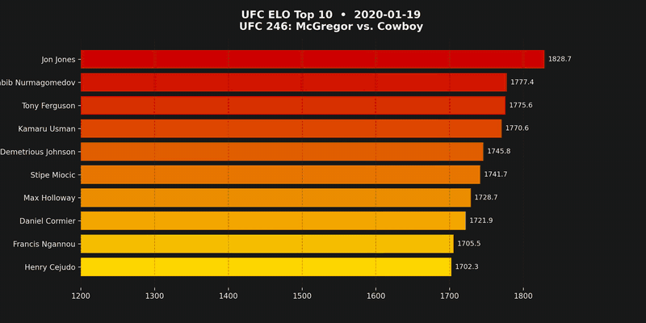

# UFC Fighter Network & ELO Rating System

A Python tool to crawl, visualize, and calculate ELO ratings for all UFC fighters using the ESPN Public API.



It BFS-crawls the fighter network from ESPN, replays every UFC fight in chronological order, and
scores each one with an MMA-specific ELO formula — finishes, title fights, opponent strength, and
win/lose streaks all move the K-factor (see [the formula](#3-calculate-elo-ratings)).

### Current top 10

| # | Fighter | ELO |
|---|---|---|
| 1 | Islam Makhachev | 1990.7 |
| 2 | Jon Jones | 1943.7 |
| 3 | Khabib Nurmagomedov | 1859.5 |
| 4 | Francis Ngannou | 1835.6 |
| 5 | Ilia Topuria | 1833.5 |
| 6 | Kamaru Usman | 1808.9 |
| 7 | Max Holloway | 1797.5 |
| 8 | Khamzat Chimaev | 1796.1 |
| 9 | Merab Dvalishvili | 1792.3 |
| 10 | Alex Pereira | 1790.7 |

<sub>Men's divisions, UFC events only; ratings as of the last crawl (Jan 2026). Retired fighters keep their final rating.</sub>

Data files aren't committed (~180 MB with the API cache) — run the [workflow](#complete-workflow-example) to rebuild them.

## Setup

1. Create and activate a virtual environment:
```bash
python3 -m venv venv
source venv/bin/activate  # On macOS/Linux
# or
venv\Scripts\activate  # On Windows
```

2. Install dependencies:
```bash
pip install -r requirements.txt
```

3. For MP4 video generation, ensure ffmpeg is installed:
```bash
brew install ffmpeg  # macOS
# or
apt-get install ffmpeg  # Linux
```

## Commands

### Data Collection

#### 1. Crawl UFC Fighter Data
Build the fighter network graph by crawling UFC fighters and their fights.

```bash
# Basic crawl (uses default seed fighters)
python -m src.main crawl

# Crawl with custom seed fighters
python -m src.main crawl --names data/seed_fighters.txt --depth 3 --limit 800

# Custom rate limiting
python -m src.main crawl --rate-limit 0.2
```

**Options:**
- `--names`: Path to file with seed fighter names (one per line)
- `--depth`: BFS traversal depth (0 = unlimited)
- `--limit`: Maximum number of fighters to collect (0 = unlimited)
- `--rate-limit`: Delay between API calls in seconds (default: 0.25)
- `--data-dir`: Directory for cached API data (default: `data/`)
- `--output-dir`: Directory for visualizations (default: `output/`)

**Outputs:**
- `data/fighters.csv` - Complete list of all UFC fighters
- `data/fight_graph.json` - Graph data structure
- `output/ufc_fighter_network.html` - Interactive network visualization

---

### ELO Calculation Pipeline

#### 2. Generate ELO-Ready Data
Filter fights, fetch fighter genders, and enhance fight data with event details.

```bash
python -m src.main elo-data

# With custom rate limiting
python -m src.main elo-data --rate-limit 0.1
```

**Outputs:**
- `data/fighter_genders.json` - Fighter gender data
- `data/enhanced_fights.json` - Fights with event names, methods, title fight status
- `data/elo_ready.json` - Chronologically sorted fights with pre-fight stats

#### 3. Calculate ELO Ratings
Calculate ELO ratings using the MMA-specific formula with multipliers.

```bash
python -m src.main calculate-elo
```

**Outputs:**
- `data/elo_ratings.json` - All fights with calculated ELO changes and final rankings

**ELO Formula:**
```
ΔElo = K × (S - E)
K = K_base × M_finish × M_title × M_opponent × M_streak × M_opp_streak
```

Multipliers:
- **M_finish**: 1.3 (KO/TKO/Submission) or 1.0 (Decision)
- **M_title**: 1.5 (title fight) or 1.0 (regular)
- **M_opponent**: 0.8-1.4 (based on opponent ELO tier)
- **M_streak**: 1.0-1.3 (winner's own win streak, +3% per fight)
- **M_opp_streak**: 0.85-1.2 (opponent's streak: -2% per lose streak, +2% per win streak)

#### 4. Build ELO History Timeline
Create timeline and fighter history data structures for querying.

```bash
python -m src.main elo-history
```

**Outputs:**
- `data/elo_timeline.json` - Top 10 fighters at each event
- `data/elo_by_fighter.json` - Individual fighter ELO histories
- `data/elo_matrix.csv` - Wide format CSV (dates × fighters)
- `data/current_rankings.csv` - Current ELO rankings

---

### Query Commands

#### 5. Top Fighters at Date
Get top N fighters ranked by ELO at any specific date.

```bash
# Top 10 on a specific date
python -m src.main top-at-date 2023-06-15

# Top 25 fighters
python -m src.main top-at-date 2023-06-15 --top 25

# Shorthand
python -m src.main top-at-date 2020-01-01 -n 50
```

**Examples:**
```bash
python -m src.main top-at-date 2015-01-01 --top 15
python -m src.main top-at-date 2025-01-01 --top 10
```

#### 6. Fighter History
Get detailed fight-by-fight ELO progression for a specific fighter.

```bash
python -m src.main fighter-history "Jon Jones"
python -m src.main fighter-history "Islam Makhachev"
python -m src.main fighter-history "Alex Pereira"
```

Shows each fight with:
- Date, event, opponent name
- Opponent's ELO at time of fight
- Result (W/L/D)
- ELO change (+/-)
- ELO after fight

#### 7. Largest ELO Gains
Find the biggest single-fight ELO gains in UFC history.

```bash
# Top 20 largest gains
python -m src.main largest-gains

# Top 10
python -m src.main largest-gains --top 10

# Shorthand
python -m src.main largest-gains -n 25
```

Shows: fighter, date, opponent, ELO change, method, title fight status

#### 8. Largest ELO Losses
Find the most punishing losses (biggest ELO drops).

```bash
python -m src.main largest-losses
python -m src.main largest-losses --top 15
python -m src.main largest-losses -n 10
```

#### 9. All-Time Peak ELOs
Get the highest ELOs ever achieved by any fighter.

```bash
# Top 50 peaks
python -m src.main all-time-peaks

# Top 25
python -m src.main all-time-peaks --top 25
python -m src.main all-time-peaks -n 100
```

Shows: fighter name, peak ELO, current ELO, difference from peak, total fights

#### 10. Fighter Analysis
Get comprehensive analysis for a specific fighter.

```bash
python -m src.main fighter-analysis "Jon Jones"
python -m src.main fighter-analysis "Kamaru Usman"
```

Shows:
- Current ELO, peak ELO, record
- Total fights, title fights, finishes
- **Best ELO gain** - Biggest win with full context
- **Worst ELO loss** - Most punishing defeat with details

---

### Visualizations

#### 11. ELO Bar Chart Race Animation
Create an animated bar chart race showing top 10 fighters over time.

```bash
# Default (60s, 30fps)
python -m src.main visualize-elo-race

# Custom output and settings
python -m src.main visualize-elo-race --output output/my_race.mp4 --fps 15 --duration 30

# Specific date range (2020-2024)
python -m src.main visualize-elo-race \
  --output output/elo_2020_2024.mp4 \
  --fps 15 \
  --duration 30 \
  --start-date 2020-01-01 \
  --end-date 2024-12-31

# Just 2023
python -m src.main visualize-elo-race \
  --output output/elo_2023.mp4 \
  --fps 15 \
  --duration 20 \
  --start-date 2023-01-01 \
  --end-date 2023-12-31

# From a date to present
python -m src.main visualize-elo-race \
  --output output/recent.mp4 \
  --fps 15 \
  --duration 30 \
  --start-date 2022-01-01
```

**Options:**
- `--output`: Output file path (.mp4 or .gif)
- `--fps`: Frames per second (default: 30)
- `--duration`: Animation duration in seconds (default: 60)
- `--start-date`: Start date (YYYY-MM-DD) - filter events
- `--end-date`: End date (YYYY-MM-DD) - filter events

**Output Format:**
- UFC-inspired dark theme with red/gold gradient bars
- Shows top 10 fighters at each event
- Bars grow/shrink and reorder as fighters rise and fall

---

## Complete Workflow Example

```bash
# 1. Crawl fighter data (if starting fresh)
python -m src.main crawl --names data/seed_fighters.txt --depth 3 --limit 800

# 2. Generate ELO-ready data
python -m src.main elo-data

# 3. Calculate ELO ratings
python -m src.main calculate-elo

# 4. Build history timeline
python -m src.main elo-history

# 5. Query and explore
python -m src.main top-at-date 2023-06-15 --top 25
python -m src.main fighter-analysis "Islam Makhachev"
python -m src.main largest-gains --top 10

# 6. Create visualizations
python -m src.main visualize-elo-race --output output/elo_race.mp4 --fps 15 --duration 30
```

---

## How It Works

### Data Collection
The crawler uses breadth-first search (BFS) to traverse the fighter network:
- **Nodes**: Fighters (ID, name, record, gender)
- **Edges**: Fights between fighters (date, event, result, method, title fight)

### ELO Calculation
ELO ratings are calculated chronologically with MMA-specific multipliers:
- **Finish bonus**: Rewards KO/TKO/Submissions
- **Title fight multiplier**: Higher stakes = bigger ELO swings
- **Opponent strength**: Based on opponent's ELO tier
- **Win streak bonus**: Winners on streaks gain more ELO
- **Streak breaker bonus**: Breaking opponent's win streak = extra bonus
- **Cold opponent penalty**: Beating fighters on losing streaks = less ELO gain

All fighters start at 1500 ELO. Each fight updates both fighters' ratings based on expected vs. actual outcome.

---

## File Structure

```
MMA_ELO/
├── data/
│   ├── cache/              # Cached API responses
│   ├── fighters.csv        # All fighters
│   ├── fight_graph.json    # Raw fight network
│   ├── fighter_genders.json
│   ├── enhanced_fights.json
│   ├── elo_ready.json      # Chronological fight data
│   ├── elo_ratings.json    # Calculated ELOs
│   ├── elo_timeline.json   # Top 10 at each event
│   ├── elo_by_fighter.json # Individual histories
│   ├── elo_matrix.csv      # Wide format (dates × fighters)
│   └── current_rankings.csv
├── output/
│   ├── ufc_fighter_network.html
│   └── elo_race.mp4
├── src/
│   ├── main.py             # CLI entry point
│   ├── crawler.py          # BFS crawler
│   ├── espn_api.py          # ESPN API client
│   ├── visualizer.py        # Network graph
│   ├── visualizer_elo.py    # Bar chart race
│   ├── gender_filter.py
│   ├── fight_enhancer.py
│   ├── elo_builder.py
│   ├── elo_calculator.py    # ELO formula
│   └── elo_history.py       # History queries
└── requirements.txt
```

---

## Notes

- API responses are cached in `data/cache/` to avoid redundant requests
- Rate limiting is configurable (default: 0.15-0.25s between calls)
- Only fights with "UFC" in the event name are included
- Focus on men's fighters only (filtered during ELO data generation)
- For MP4 output, ffmpeg must be installed on your system

